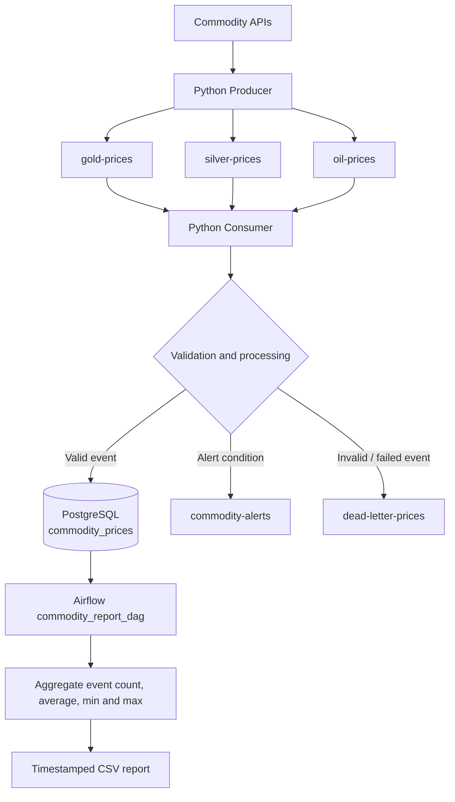
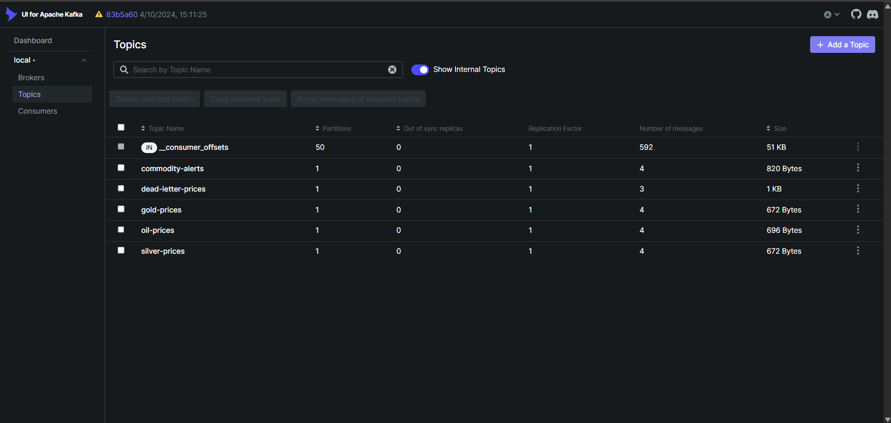
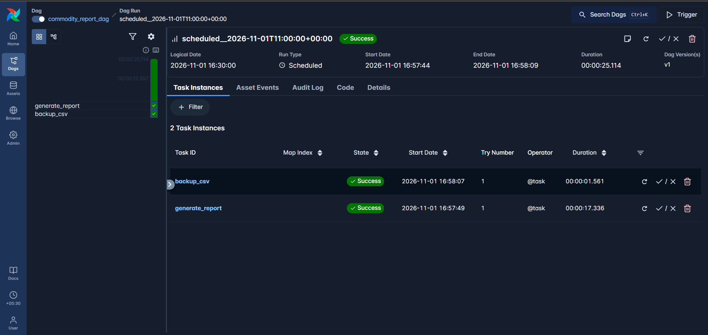
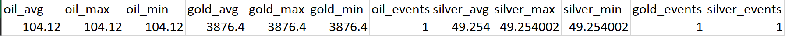

# Kafka-Based Commodity Market Streaming Pipeline

A local end-to-end data engineering project that ingests commodity prices, streams events through Apache Kafka, validates and stores them in PostgreSQL, and uses Apache Airflow to generate an analytics CSV report.

## Overview

The pipeline tracks three commodities:

- Gold (`gold`)
- Silver (`silver`)
- Crude oil (`oil`)

Python producer scripts retrieve commodity prices from external APIs and publish events to Kafka. A Kafka consumer processes the events, applies the project's validation and alert logic, and stores valid records in PostgreSQL. Alert events and invalid events are published to dedicated Kafka topics. An Airflow DAG reads the stored data, calculates summary metrics, and writes a timestamped CSV report.

This repository is the standalone copy under `Projects/commodity-market-streaming-pipeline`. It is designed to run independently of the original coursework folders.

## Architecture



## Features

- Commodity price ingestion from external APIs
- Kafka producers and consumers
- Separate Kafka topics for gold, silver and oil prices
- Event validation and PostgreSQL storage
- Commodity alert topic (`commodity-alerts`)
- Dead Letter Queue topic (`dead-letter-prices`)
- Apache Airflow orchestration
- Per-commodity event count, average, minimum and maximum price calculations
- Timestamped CSV report generation
- Docker Compose-based local infrastructure
- Environment-variable-based configuration

## Technology Stack

- Python
- Apache Kafka and Zookeeper
- Apache Airflow 3.2.1
- PostgreSQL 15 (commodity data)
- PostgreSQL 16 (Airflow metadata)
- Pandas
- Docker Compose
- `kafka-python`
- `psycopg2`
- Requests / yFinance (for external market data, as used by the producer code)

## Repository Structure

```text
commodity-market-streaming-pipeline/
├── Kafka/
│   ├── commodity_producer.py
│   ├── commodity_api_producer.py
│   ├── commodity_consumer.py
│   ├── commodity_alerts.py
│   ├── dlq_consumer.py
│   ├── commodity_report.py
│   ├── admin.py
│   ├── docker-compose.yml
│   ├── .env.example
│   └── .env                  # local only; do not commit
│
├── Airflow/
│   ├── dags/
│   │   └── commodity_dag.py
│   ├── logs/                 # generated at runtime; do not commit
│   ├── plugins/
│   ├── reports/              # generated CSV reports
│   ├── docker-compose.yaml
│   ├── .env.example
│   └── .env                  # local only; do not commit
│
├── screenshots/
│   ├── kafka-ui-topics.png
│   ├── airflow-dag-success.png
│   └── commodity-report-csv.png
│
├── .gitignore
└── README.md
```

## Kafka Topics

| Topic | Purpose |
|---|---|
| `gold-prices` | Gold price events |
| `silver-prices` | Silver price events |
| `oil-prices` | Crude oil price events |
| `commodity-alerts` | Events that meet the configured commodity alert conditions |
| `dead-letter-prices` | Invalid events or events that fail processing/storage |

The exact alert thresholds and validation rules are defined in the Python consumer code. Check those rules before changing them, because API price units and currencies can differ by source.

## PostgreSQL Table

The consumer writes valid events to `commodity_prices`.

| Column | Description |
|---|---|
| `id` | Auto-incrementing primary key |
| `commodity` | Commodity name (`gold`, `silver` or `oil`) |
| `price` | Price value |
| `currency` | Currency supplied with the event |
| `timestamp` | Event timestamp |

### Initialize the table

For a fresh PostgreSQL data volume, create the table before starting the consumer unless the Kafka Compose configuration mounts an initialization SQL script into `/docker-entrypoint-initdb.d/`.

From the project root, start Kafka first (see below), then run:

```bash
docker exec -it commodity-kafka-postgres-1 psql -U postgres -d kafka_db
```

At the `psql` prompt, execute:

```sql
CREATE TABLE IF NOT EXISTS commodity_prices (
    id BIGSERIAL PRIMARY KEY,
    commodity VARCHAR(50) NOT NULL,
    price NUMERIC(18,6) NOT NULL,
    currency VARCHAR(10) NOT NULL,
    timestamp TIMESTAMP WITHOUT TIME ZONE NOT NULL
);
```

Exit with `\q`.

## Local Setup

### Prerequisites

- Windows with Docker Desktop running (this setup uses Docker Desktop host networking names such as `host.docker.internal`)
- Git Bash or another terminal that can run the commands below
- Python 3.10 or compatible version for the producer and consumer scripts
- Python packages used by the scripts: `kafka-python`, `psycopg2-binary`, `requests` and `yfinance`

Install the Python packages in your active Python environment:

```bash
python -m pip install kafka-python psycopg2-binary requests yfinance
```

Airflow runs in Docker. The Airflow image installs Pandas through its Compose environment configuration, as required by the reporting DAG.

### 1. Configure environment files

Create local environment files from the examples:

```bash
cp Kafka/.env.example Kafka/.env
cp Airflow/.env.example Airflow/.env
```

Edit both `.env` files and supply your own values. Never commit `.env` files or paste their secrets into screenshots.

The Kafka `.env` must provide the PostgreSQL connection values used by the Windows Python scripts. The local host port for the commodity database is `5434`:

```env
POSTGRES_HOST=127.0.0.1
POSTGRES_DB=kafka_db
POSTGRES_USER=postgres
POSTGRES_PASSWORD=<your-kafka-postgres-password>
POSTGRES_PORT=5434
```

The Airflow `.env` must provide its own metadata database credentials, plus the connection to the Kafka PostgreSQL database:

```env
AIRFLOW_UID=50000
AIRFLOW_DB_USER=airflow
AIRFLOW_DB_PASSWORD=<your-airflow-metadata-password>
AIRFLOW_DB_NAME=airflow

KAFKA_HOST=host.docker.internal
KAFKA_DB=kafka_db
KAFKA_USER=postgres
KAFKA_PASSWORD=<same-kafka-postgres-password-as-Kafka-env>
POSTGRES_PORT=5434
```

Use the variable names in the supplied `.env.example` files and the Compose files as the source of truth if they differ from this illustrative block. The Airflow metadata database and the Kafka commodity database are separate databases with separate credentials.

### 2. Start the Kafka stack

Open a terminal in the repository root and run:

```bash
cd Kafka

docker compose -p commodity-kafka up -d

docker compose -p commodity-kafka ps
```

Wait until the Kafka service reports `healthy`.

Open Kafka UI:

- Kafka UI: <http://localhost:8081>
- Kafka broker from Python running on Windows: `127.0.0.1:9092`
- Kafka broker from containers on the Compose network: `kafka:29092`

### 3. Start the Airflow stack

Open a second terminal in the repository root and run:

```bash
cd Airflow

docker compose -p commodity-airflow up -d

docker compose -p commodity-airflow ps
```

Wait for Airflow initialization and the API server to finish starting. Open:

- Airflow UI: <http://localhost:8080>

The Airflow 3 Simple Auth Manager generates an initial admin password. Read it locally from the container:

```bash
docker exec commodity-airflow-airflow-1 sh -c 'cat "${AIRFLOW_HOME:-/opt/airflow}/simple_auth_manager_passwords.json.generated"'
```

Log in with username `admin` and the generated password. Keep the password private.

### 4. Run the consumer, then the producer

The Python scripts run on the Windows host and connect to Kafka at `127.0.0.1:9092` and PostgreSQL at `127.0.0.1:5434`.

Open a third terminal, navigate to `Kafka`, and load the local environment variables into Git Bash before starting the consumer:

```bash
cd Kafka
set -a
source .env
set +a
python commodity_consumer.py
```

Keep the consumer running. Open another terminal and run the producer:

```bash
cd Kafka
set -a
source .env
set +a
python commodity_producer.py
```

Start the consumer before the producer so it is ready to receive events. The producer retrieves commodity data and publishes events to Kafka; the consumer validates/processes those events and writes valid records to PostgreSQL.

### 5. Verify PostgreSQL records

```bash
docker exec -it commodity-kafka-postgres-1 psql -U postgres -d kafka_db
```

Example query:

```sql
SELECT COUNT(*) FROM commodity_prices;

SELECT
    commodity,
    COUNT(*) AS total_events,
    ROUND(AVG(price), 2) AS average_price,
    MAX(price) AS highest_price,
    MIN(price) AS lowest_price
FROM commodity_prices
GROUP BY commodity
ORDER BY commodity;
```

### 6. Run the Airflow reporting DAG

In Airflow UI (<http://localhost:8080>):

1. Find `commodity_report_dag`.
2. Trigger a manual run.
3. Open the DAG Grid/Graph view.
4. Confirm that both `generate_report` and `backup_csv` complete successfully.

The DAG runs on an hourly schedule (`@hourly`) with `catchup=False`; a manual trigger can be used for validation.

### 7. Verify the CSV report

The Airflow Compose file bind-mounts the local `Airflow/reports` directory into `/opt/airflow/reports` in the container. The DAG writes timestamped CSV files there.

From the repository root:

```bash
ls -lah Airflow/reports/
```

Open the newest `market_data_*.csv` file and compare its values with the PostgreSQL aggregation query above. The CSV currently stores the calculated per-commodity metrics as a single record with separate fields for Gold, Silver and Oil.

## Port Configuration

These are the host ports used by this local Docker Desktop setup:

| Service | Host address / port | Purpose |
|---|---|---|
| Zookeeper | `localhost:2181` | Kafka coordination |
| Kafka (host listener) | `127.0.0.1:9092` | Producer/consumer running on Windows |
| Kafka (container listener) | `kafka:29092` | Kafka UI and containers on the Kafka Compose network |
| Kafka UI | `http://localhost:8081` | Kafka topic and broker UI |
| Kafka PostgreSQL | `127.0.0.1:5434` | Commodity database from Windows Python |
| Airflow UI / API server | `http://localhost:8080` | Airflow web interface |
| Airflow metadata PostgreSQL | `localhost:5433` (host mapping) / `postgres:5432` (inside Airflow Compose network) | Airflow's own metadata database |

Airflow runs in a separate Compose project/network from Kafka. The reporting DAG reaches the Kafka PostgreSQL database through `host.docker.internal:5434`. Inside the Airflow Compose network, the Airflow metadata database remains `postgres:5432`.

## Stop the Project

Stop Airflow first:

```bash
cd Airflow
docker compose -p commodity-airflow down
```

Then stop Kafka:

```bash
cd ../Kafka
docker compose -p commodity-kafka down
```

These commands stop and remove the containers and networks but preserve named database volumes. Do **not** add `-v` unless you intentionally want to delete the databases and their data.

## Screenshots

Add the following screenshots to the `screenshots/` folder. Capture them from your local running setup and ensure no passwords, `.env` values, API keys or other credentials are visible.

### Kafka UI — topics



### Airflow — successful DAG run



### CSV analytics report



## Author

Abhishek Wafare
