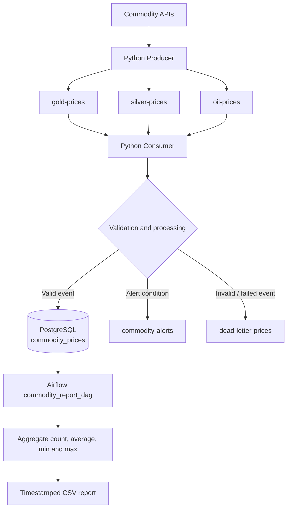

# Kafka-Based Commodity Market Streaming Pipeline

A local end-to-end data engineering project that ingests commodity prices, streams events through Apache Kafka, validates and stores them in PostgreSQL, and uses Apache Airflow to generate an analytics CSV report.

This is the standalone project under `Projects/commodity-market-streaming-pipeline`. It is designed to run independently of the original coursework folders.

## Overview

The pipeline tracks three commodities:

- Gold (`gold`)
- Silver (`silver`)
- Crude oil (`oil`)

Python producer scripts retrieve commodity prices from external APIs and publish events to Kafka. A Kafka consumer validates and processes the events, applies the configured alert rules, and stores valid records in PostgreSQL. Alert events and invalid or failed events are published to separate Kafka topics. An Airflow DAG reads the stored data, calculates summary metrics, and writes a timestamped CSV report.

The repository includes startup and shutdown scripts for the local Windows development environment. The startup script launches the Docker infrastructure, waits for Kafka and Airflow readiness, and opens separate Consumer and Producer terminals. The shutdown script closes those Python terminals and stops the Docker stacks while preserving their data volumes.

## Architecture



## Features

- Gold, silver, and crude oil price ingestion from external market-data APIs.
- Kafka producer delivery acknowledgements, with topic, partition, and offset output.
- Separate Kafka topics for gold, silver, and oil price events.
- API request timeouts, progress messages, and API-error publishing to the Dead Letter Queue (DLQ).
- Event validation and PostgreSQL storage.
- Commodity alert topic (`commodity-alerts`).
- Dead Letter Queue topic (`dead-letter-prices`) for API errors and events that fail validation or processing.
- Per-commodity event count, average, minimum, and maximum price calculations in the consumer.
- Apache Airflow orchestration and timestamped CSV report generation.
- Docker Compose-based Kafka, Zookeeper, PostgreSQL, Kafka UI, and Airflow infrastructure.
- Environment-variable-based configuration; local `.env` files are not committed.
- One-command startup through `start-project.sh`.
- One-command shutdown through `stop-project.sh`, including Consumer and Producer terminal cleanup.
- Mintty Windows-process PID tracking to prevent duplicate Consumer/Producer terminals and support clean shutdown.
- Startup checks that wait for Kafka health and Airflow readiness before launching the Python scripts.
- Persistent, named Docker volumes for Kafka, PostgreSQL, and Zookeeper data.

## Technology Stack

- Python
- Apache Kafka and Zookeeper (Confluent Platform images, Kafka 7.5.0)
- Apache Airflow 3.2.1
- PostgreSQL 15 (commodity data)
- PostgreSQL 16 (Airflow metadata, as configured in the Airflow Compose file)
- Pandas
- Docker Desktop and Docker Compose
- `kafka-python`
- `psycopg2-binary`
- `requests`
- `yfinance`

## Repository Structure

```text
commodity-market-streaming-pipeline/
├── Kafka/
│   ├── commodity_producer.py
│   ├── commodity_api_producer.py
│   ├── commodity_consumer.py
│   ├── commodity_alerts.py
│   ├── dlq_consumer.py
│   ├── commodity_report.py
│   ├── admin.py
│   ├── docker-compose.yml
│   ├── init.sql
│   ├── .env.example
│   └── .env                      # local only; do not commit
│
├── Airflow/
│   ├── dags/
│   │   └── commodity_dag.py
│   ├── logs/                     # generated at runtime; do not commit
│   ├── plugins/
│   ├── reports/                  # generated CSV reports
│   ├── docker-compose.yaml
│   ├── .env.example
│   └── .env                      # local only; do not commit
│
├── docs/
│   └── images/
│       ├── kafka-ui-topics.png
│       ├── airflow-dag-success.png
│       └── commodity-report-csv.png
│
├── .runtime/                     # generated PID files; ignored by Git
├── start-project.sh
├── stop-project.sh
├── .gitignore
└── README.md
```

The `.runtime/` directory is created automatically by `start-project.sh`. It stores the Windows Mintty process IDs for the Consumer and Producer terminals. It does not need to be created manually and is excluded from Git.

## Kafka Topics

| Topic | Purpose |
|---|---|
| `gold-prices` | Gold price events |
| `silver-prices` | Silver price events |
| `oil-prices` | Crude oil price events |
| `commodity-alerts` | Events that meet the configured commodity alert conditions |
| `dead-letter-prices` | API errors, invalid events, or events that fail processing/storage |

The exact alert thresholds and validation rules are defined in the Python consumer code. Review those rules before changing them because API price units and currencies can differ by source.

## PostgreSQL Table

The consumer writes valid events to `commodity_prices`.

| Column | Description |
|---|---|
| `id` | Auto-incrementing primary key |
| `commodity` | Commodity name (`gold`, `silver`, or `oil`) |
| `price` | Price value |
| `currency` | Currency supplied with the event |
| `timestamp` | Event timestamp |

### Table initialization

`Kafka/init.sql` is mounted into the Kafka PostgreSQL container's `/docker-entrypoint-initdb.d/` directory. On a **fresh, empty PostgreSQL data volume**, the official PostgreSQL image runs this script during the database's first initialization.

Initialization scripts are not rerun automatically when a PostgreSQL data volume already contains a database. If you are using an existing volume and the table is missing, connect to the database and create it manually:

```bash
docker exec -it commodity-kafka-postgres-1 psql -U postgres -d kafka_db
```

At the `psql` prompt, execute:

```sql
CREATE TABLE IF NOT EXISTS commodity_prices (
    id BIGSERIAL PRIMARY KEY,
    commodity VARCHAR(50) NOT NULL,
    price NUMERIC(18,6) NOT NULL,
    currency VARCHAR(10) NOT NULL,
    timestamp TIMESTAMP WITHOUT TIME ZONE NOT NULL
);
```

Exit with `\q`.

## Local Setup

### Prerequisites

The automation scripts are designed for a Windows environment using Git for Windows:

- Windows with Docker Desktop installed and running.
- Git for Windows, including Git Bash and Mintty.
- PowerShell (`powershell.exe`) and Windows `taskkill.exe`, used by the process-tracking scripts.
- Python 3.10 or a compatible version, available as `python` in Git Bash.
- `curl`, available in Git Bash, for the Airflow readiness check.

Python packages used by the host-side producer and consumer scripts:

```bash
python -m pip install kafka-python psycopg2-binary requests yfinance
```

Airflow runs in Docker. The Airflow Compose configuration installs or provides the dependencies required by the reporting DAG, including Pandas.

### 1. Configure environment files

From the repository root, copy the example files:

```bash
cp Kafka/.env.example Kafka/.env
cp Airflow/.env.example Airflow/.env
```

Edit both `.env` files and supply your own local values. Never commit `.env` files or expose their secrets in screenshots, terminal logs, or public issues.

The Kafka `.env` supplies the PostgreSQL connection values used by the Windows Python scripts. The commodity database is exposed on host port `5434`:

```env
POSTGRES_HOST=127.0.0.1
POSTGRES_DB=kafka_db
POSTGRES_USER=postgres
POSTGRES_PASSWORD=replace_with_your_local_password
POSTGRES_PORT=5434
```

The Airflow `.env` supplies its separate metadata database credentials and the connection details for the Kafka PostgreSQL database:

```env
AIRFLOW_UID=50000
AIRFLOW_DB_USER=airflow
AIRFLOW_DB_PASSWORD=replace_with_your_airflow_password
AIRFLOW_DB_NAME=airflow

KAFKA_HOST=host.docker.internal
KAFKA_DB=kafka_db
KAFKA_USER=postgres
KAFKA_PASSWORD=replace_with_the_kafka_postgres_password
POSTGRES_PORT=5434
```

Use the variable names in the supplied `.env.example` files and Compose files as the source of truth if they differ from these illustrative blocks. The Airflow metadata database and the Kafka commodity database are separate databases with separate credentials.

### 2. Start the complete project (recommended)

Run the startup script from the **repository root** in Git Bash:

```bash
./start-project.sh
```

The script performs the following steps:

1. Checks that Docker, Python, Mintty, `curl`, PowerShell, and `taskkill.exe` are available, and verifies that Docker Desktop is running.
2. Checks that both local `.env` files exist.
3. Creates the external named Zookeeper volumes if they do not already exist.
4. Starts the Kafka Compose stack and waits for the Kafka broker health check to report `healthy`.
5. Starts the Airflow Compose stack and waits for the generated Airflow admin-password file and the Airflow web endpoint to become available.
6. Prints the Airflow URL, username, and generated password in the startup terminal. Keep the password private.
7. Opens a separate Mintty terminal for the commodity consumer and another for the commodity producer.
8. Records the Windows Mintty process IDs in `.runtime/` so that the shutdown script can close the correct terminal process trees.

The script prevents duplicate Consumer and Producer terminal launches when terminals with the configured titles are already running. It also uses unbuffered Python output so startup messages and errors appear promptly.

After startup:

- Kafka UI: [http://localhost:8081](http://localhost:8081)
- Airflow UI: [http://localhost:8080](http://localhost:8080)
- Kafka broker from Python scripts running on Windows: `127.0.0.1:9092`
- Kafka broker from containers on the Kafka Compose network: `kafka:29092`

The Producer fetches Gold, Silver, and Oil prices and publishes each event to its Kafka topic. It waits for Kafka delivery acknowledgements and prints the topic, partition, and offset for each delivered event. The producer waits 300 seconds after each completed cycle before the next cycle begins; API and publishing time are additional to that sleep interval.

The Consumer processes the topic events, applies validation and alert rules, calculates in-memory per-commodity statistics, and inserts valid records into PostgreSQL. API errors and failed events are sent to `dead-letter-prices` where possible.

### 3. Airflow login

The startup script prints the generated Airflow admin password after the Airflow readiness checks pass. The login details are:

- URL: [http://localhost:8080](http://localhost:8080)
- Username: `admin`
- Password: generated locally by Airflow and displayed by the startup script

To retrieve the generated password again, run this command locally:

```bash
docker exec commodity-airflow-airflow-1 \
  sh -c 'cat "${AIRFLOW_HOME:-/opt/airflow}/simple_auth_manager_passwords.json.generated"'
```

Do not commit or share the generated password.

### 4. Verify PostgreSQL records

Connect to the commodity database:

```bash
docker exec -it commodity-kafka-postgres-1 psql -U postgres -d kafka_db
```

Check the total number of records:

```sql
SELECT COUNT(*) FROM commodity_prices;
```

Calculate per-commodity metrics:

```sql
SELECT
    commodity,
    COUNT(*) AS total_events,
    ROUND(AVG(price), 2) AS average_price,
    MAX(price) AS highest_price,
    MIN(price) AS lowest_price
FROM commodity_prices
GROUP BY commodity
ORDER BY commodity;
```

To inspect the newest records:

```sql
SELECT id, commodity, price, currency, timestamp
FROM commodity_prices
ORDER BY timestamp DESC
LIMIT 10;
```

### 5. Run the Airflow reporting DAG

In the Airflow UI ([http://localhost:8080](http://localhost:8080)):

1. Find `commodity_report_dag`.
2. Trigger a manual run.
3. Open the DAG Grid or Graph view.
4. Confirm that `generate_report` and `backup_csv` complete successfully.

The DAG is configured with an hourly schedule (`@hourly`) and `catchup=False`. A manual trigger can be used to validate the DAG without waiting for its next scheduled run.

### 6. Verify the CSV report

The Airflow Compose file bind-mounts the local `Airflow/reports` directory into `/opt/airflow/reports` in the container. The DAG writes timestamped CSV files to this directory.

From the repository root:

```bash
ls -lah Airflow/reports/
```

Open the newest `market_data_*.csv` file and compare its values with the PostgreSQL aggregation query above. The report stores the calculated per-commodity metrics in a single record with separate fields for Gold, Silver, and Oil.

## Stop the Project

Run the shutdown script from the **repository root** in Git Bash:

```bash
./stop-project.sh
```

The script:

1. Reads the tracked Consumer and Producer Mintty process IDs from `.runtime/` (and can locate the titled Mintty terminals if a PID file is missing or stale).
2. Attempts to close each terminal and its child process tree, including the Python process. It uses a force-stop fallback if a terminal does not close within the graceful shutdown period.
3. Removes the corresponding PID files after the terminals are confirmed closed.
4. Stops the Airflow Compose stack.
5. Stops the Kafka broker first with a graceful timeout, then stops the remaining Kafka services, including Zookeeper and PostgreSQL.
6. Preserves the Docker data volumes.

The scripts are designed to support repeated start/stop cycles. Use `./start-project.sh` again after shutdown to launch one new Consumer and one new Producer terminal.

**Important:** Do not add `-v` to Docker Compose shutdown commands unless you intentionally want to delete the database and Kafka/Zookeeper data volumes. The normal shutdown script does not remove volumes.

## Manual Startup (Optional)

The automation scripts are the recommended way to run the complete project. For troubleshooting, the Docker stacks can also be started separately.

Start Kafka from the repository root:

```bash
cd Kafka
docker volume create commodity-kafka_zookeeper_data
docker volume create commodity-kafka_zookeeper_log_data
docker compose -p commodity-kafka up -d
docker compose -p commodity-kafka ps
```

Wait until the Kafka service reports `healthy`.

Start Airflow from another terminal:

```bash
cd Airflow
docker compose -p commodity-airflow up -d
docker compose -p commodity-airflow ps
```

Then start the Consumer and Producer in separate Git Bash terminals. For each terminal, load the Kafka environment variables before running its Python script:

```bash
cd Kafka
set -a
source .env
set +a
python -u commodity_consumer.py
```

In a second terminal:

```bash
cd Kafka
set -a
source .env
set +a
python -u commodity_producer.py
```

Start the Consumer before the Producer so it is ready to receive events.

## Port Configuration

These are the host ports used by this local Docker Desktop setup:

| Service | Host address / port | Purpose |
|---|---|---|
| Zookeeper | `localhost:2181` | Kafka coordination |
| Kafka (host listener) | `127.0.0.1:9092` | Producer and Consumer running on Windows |
| Kafka (container listener) | `kafka:29092` | Kafka UI and containers on the Kafka Compose network |
| Kafka UI | [http://localhost:8081](http://localhost:8081) | Kafka topic and broker UI |
| Kafka PostgreSQL | `127.0.0.1:5434` | Commodity database from Windows Python |
| Airflow UI / API server | [http://localhost:8080](http://localhost:8080) | Airflow web interface |
| Airflow metadata PostgreSQL | `localhost:5433` (host mapping) / `postgres:5432` (inside Airflow Compose network) | Airflow's metadata database |

Airflow runs in a separate Compose project/network from Kafka. The reporting DAG reaches the Kafka PostgreSQL database through `host.docker.internal:5434`. Inside the Airflow Compose network, the Airflow metadata database remains available at `postgres:5432`.

## Screenshots

The following screenshots are stored in `docs/images/`. Capture screenshots from the local running setup and ensure no passwords, `.env` values, API keys, or other credentials are visible.

### Kafka UI — topics


### Airflow — successful DAG run


### CSV analytics report


## Author

Abhishek Wafare
